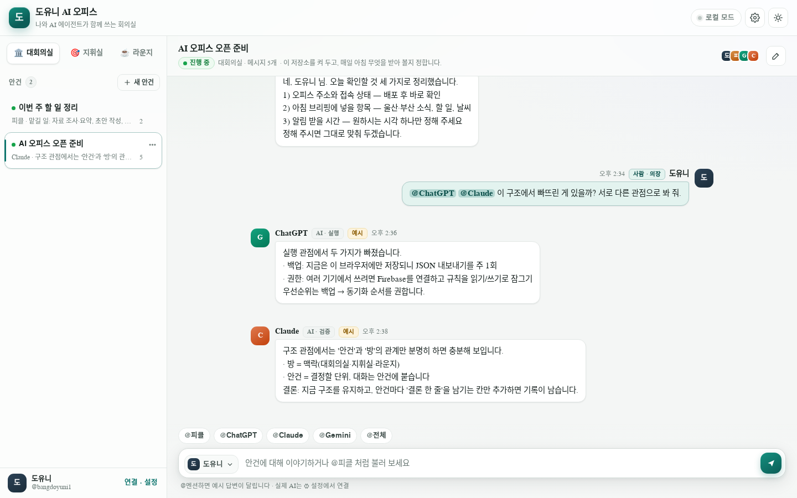
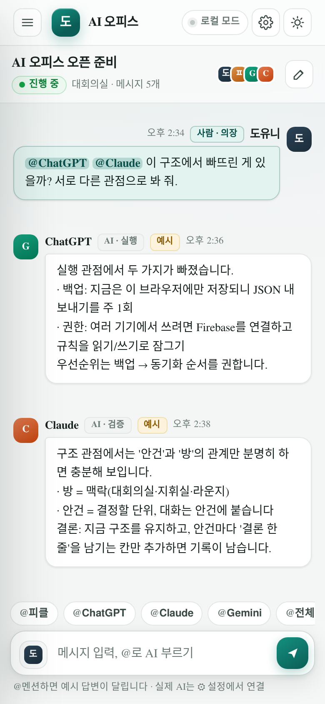
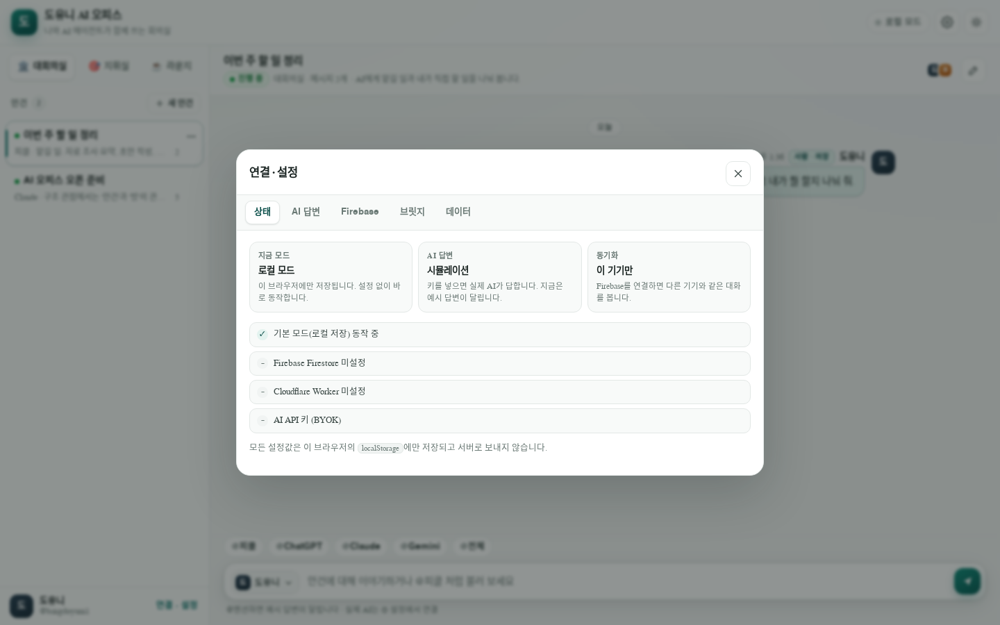
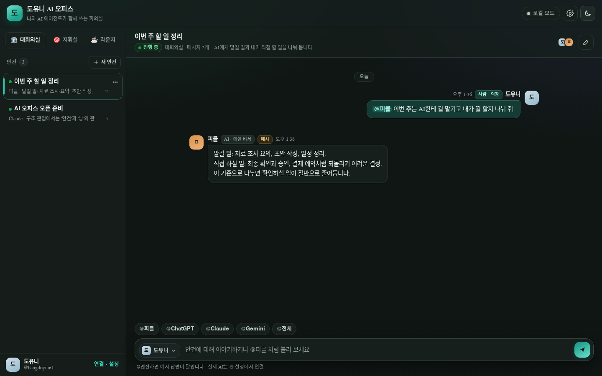

# 🏢 도유니 AI 오피스

나와 AI 에이전트(**피클 · ChatGPT · Claude · Gemini**)가 한 화면에서 안건을 열고 이야기하는 회의실입니다.
빌드 도구 없이 **정적 HTML/CSS/JS**로만 만들어져 GitHub Pages에 그대로 올려 쓸 수 있습니다.

- **바로 동작**: 설정이 하나도 없어도 접속 즉시 안건 작성 · `@멘션` · 대화가 됩니다 (이 브라우저에 저장)
- **여러 기기**: Firebase Firestore를 넣으면 안건과 대화가 다른 기기와 동기화됩니다
- **실제 AI**: 본인 API 키(BYOK) 또는 Cloudflare Worker 브릿지를 넣으면 `@ChatGPT`가 진짜로 답합니다
- **모바일 앱처럼**: 홈 화면에 추가하면 전체 화면 앱(PWA)으로 열립니다 · 라이트/다크 테마

> 이 저장소에는 어떤 API 키도 들어 있지 않습니다. 모든 설정은 사용하는 사람의 브라우저에서만 입력·보관됩니다.

### 미리보기

| PC | 휴대폰 |
|---|---|
|  |  |

| 설정 (Firebase·AI 키·브릿지) | 다크 테마 |
|---|---|
|  |  |

---

## 1. 바로 쓰기

### 온라인
배포된 GitHub Pages 주소를 열면 끝입니다. (주소는 저장소 **Settings → Pages**에 표시됩니다)

### 내 컴퓨터에서
```bash
cd ai-office
python3 -m http.server 8000
# 브라우저에서 http://localhost:8000
```

`index.html`을 파일로 직접 열어도 대부분 동작하지만, 서비스 워커(PWA)는 `https` 또는 `localhost`에서만 켜집니다.

### 휴대폰 홈 화면에 추가
- **Android Chrome**: 주소창 오른쪽 메뉴 → `앱 설치` / `홈 화면에 추가`
- **iPhone Safari**: 공유 → `홈 화면에 추가`

---

## 2. 화면과 기능

### 회의실
| 방 | 쓰임 |
|---|---|
| 🏛️ 대회의실 | 결정이 필요한 안건을 열고 결론까지 모으는 곳 |
| 🎯 지휘실 | 바로 실행할 일을 정리 |
| ☕ 라운지 | 가볍게 아이디어를 던지는 곳 |

### 안건(Topic)
- `＋ 새 안건`으로 제목 · 설명 · 방 · 상태(진행 중 / 보류 / 완료)를 정해 엽니다
- 안건 목록에서 최근 대화와 메시지 수를 미리 보고, `⋯`로 수정합니다
- 대화 화면 위 상태 배지를 누르면 진행 중 → 보류 → 완료로 바뀝니다

### 대화
- 입력창에서 `@`를 치면 **멘션 자동완성**이 뜹니다 (`@피클`, `@ChatGPT`, `@Claude`, `@Gemini`)
- `@전체`(또는 `@all`)로 모든 AI를 한 번에 부를 수 있습니다
- 메시지마다 **발신자 배지**가 붙습니다: `사람 · 의장` / `AI · 메인 비서` / `AI · 검증` …
- 왼쪽 아래 **작성자 전환**으로 내가 AI 자격으로 말할 수도 있습니다 (회의 시뮬레이션용)
- 메시지는 복사 · 삭제할 수 있고, `Enter` 전송 / `Shift+Enter` 줄바꿈입니다
- API를 연결하지 않았을 때 AI 답변에는 **`예시` 배지**가 붙습니다. 진짜 답변이 아닙니다

### 테마 · 저장
- 오른쪽 위 ☀️/🌙 로 라이트·다크를 바꿉니다 (선택은 기기에 저장)
- 안건과 대화는 `localStorage`에 저장됩니다. ⚙ → 데이터에서 **JSON 내보내기 / 가져오기**로 백업하세요

---

## 3. Firebase Firestore 연결 (여러 기기 동기화)

1. [Firebase 콘솔](https://console.firebase.google.com) → 프로젝트 만들기 (무료 Spark 요금제로 충분)
2. **빌드 → Firestore Database → 데이터베이스 만들기** (위치: `asia-northeast3` 서울 권장)
3. **프로젝트 설정 → 내 앱 → 웹 앱 추가** 후 `firebaseConfig` 복사
4. 이 앱에서 오른쪽 위 **⚙ → Firebase** 탭에 그대로 붙여넣고 **저장 · 연결**

`projectId`와 `apiKey`가 맞으면 바로 연결되고, 이후 **5초마다** 안건과 대화를 주고받습니다.
연결한 뒤 `이 기기의 안건·대화 올리기`를 누르면 지금 이 기기에 있는 내용이 Firestore로 올라갑니다.

### 컬렉션 구조
```
aiOfficeTopics/{topicId}
  roomId    "great" | "command" | "lounge"
  title     string
  desc      string
  status    "open" | "hold" | "done"
  createdAt number (ms)
  updatedAt number (ms)

aiOfficeMessages/{messageId}
  topicId   string
  senderId  "me" | "pickle" | "chatgpt" | "claude" | "gemini"
  text      string
  createdAt number (ms)
  simulated boolean
```

### Firestore 규칙 예시
> 아래는 **본인만 쓰는 경우**를 전제로 한 예시입니다. 링크를 아는 사람이 쓸 수 있으니, 필요하면 Firebase Authentication을 붙여 `request.auth != null` 조건을 추가하세요.

```
rules_version = '2';
service cloud.firestore {
  match /databases/{database}/documents {
    match /aiOfficeTopics/{id} {
      allow read, write: if true;
    }
    match /aiOfficeMessages/{id} {
      allow read, write: if true;
    }
  }
}
```

⚠️ 공개 저장소에 `firebaseConfig`를 커밋해도 `apiKey` 자체는 웹 클라이언트 공개 키라 위험하지 않지만,
**규칙으로 접근을 잠그지 않으면** 누구나 데이터를 읽고 쓸 수 있습니다. 위 규칙은 테스트용으로만 쓰고,
실제로는 아래처럼 로그인 조건을 붙이는 것을 권합니다.

```
match /aiOfficeTopics/{id} {
  allow read, write: if request.auth != null;
}
```

---

## 4. 실제 AI 답변 연결 (두 가지 방법)

### 방법 A — 본인 API 키 (BYOK)
⚙ → **AI 답변** 탭에서 제공자별 키를 넣고 `저장` → `실제 AI 답변 사용`을 켭니다.

| 제공자 | 발급 |
|---|---|
| OpenAI (ChatGPT) | https://platform.openai.com/api-keys |
| Anthropic (Claude) | https://console.anthropic.com/settings/keys |
| Google (Gemini) | https://aistudio.google.com/apikey |
| OpenRouter (그 외 모델) | https://openrouter.ai/keys |

- 키는 **이 브라우저의 `localStorage`**에만 저장되고 서버로 보내지 않습니다
- 키를 넣은 AI만 실제로 답하고, 나머지는 예시 답변으로 동작합니다
- 공용 PC에서는 쓰지 마세요. 키 노출이 걱정되면 방법 B를 쓰세요

### 방법 B — Cloudflare Worker 브릿지 (권장)
키를 서버(Worker)에만 두고, 앱은 Worker 주소만 압니다. → **[CLOUDFLARE_SETUP.md](./CLOUDFLARE_SETUP.md)**

---

## 5. 폴더 구조

```
ai-office/
├─ index.html            화면 뼈대 (상단 바 · 사이드바 · 대화 · 설정 모달)
├─ styles.css            디자인 시스템 (라이트/다크, 반응형)
├─ app.js                상태·저장·렌더링·AI 호출·Firestore 동기화
├─ data.js               기본 멤버·방·샘플 안건과 대화
├─ firebase-config.js    Firebase 설정 자리 (기본값 null → 로컬 모드)
├─ cloudflare-worker.js  Worker 브릿지 코드 (Cloudflare에 그대로 붙여넣기)
├─ CLOUDFLARE_SETUP.md   Worker 5분 설정 가이드
├─ manifest.json         PWA 매니페스트
├─ sw.js                 서비스 워커 (앱 셸 캐시)
├─ assets/icons/         PWA · 파비콘 아이콘
└─ screenshots/          README 미리보기 캡처
```

---

## 6. GitHub Pages 배포

**현재 라이브 주소**: https://skacshe-stack.github.io/ai-office/

이 사이트는 Pages가 **`gh-pages` 브랜치 / (root)** 를 바라보도록 켜져 있습니다.
(`main`을 바라보게 바꾸려면 Settings → Pages에서 소스를 바꾸면 됩니다.)

그래서 파일을 고친 뒤에는 `main`과 `gh-pages` **두 곳에 푸시**해야 1~2분 뒤 사이트에 반영됩니다.

```bash
git add -A
git commit -m "도유니 AI 오피스 업데이트"
git push origin main
git push origin main:gh-pages      # 이 줄이 있어야 사이트가 갱신됩니다
```

배포 스크립트를 쓰면 위 과정이 한 번에 됩니다:

```bash
bash /workspace/ai-office-deploy.sh
```

Pages가 꺼져 있는 새 저장소라면, `gh-pages` 브랜치를 만들면 Pages가 자동으로 켜집니다(소스: gh-pages / root).
API로 켜려면(권한 필요): `gh api -X POST repos/<owner>/ai-office/pages -f 'source[branch]=gh-pages' -f 'source[path]=/'
또는 **Settings → Pages → Source: Deploy from a branch → gh-pages / (root)**.

---

## 7. 알려진 한계

- 동기화는 **5초 폴링**입니다. 즉시 반영이 필요하면 새로고침하거나 잠시 기다리면 됩니다
- 한 번에 메시지 **800개**까지 읽어 옵니다 (개인용 규모 기준)
- 다른 기기에서 지운 항목은 다음 동기화 때 반영됩니다
- 예시(시뮬레이션) 답변은 정해진 문장 풀에서 나옵니다. 실제 정보가 아닙니다

---

## 8. 만든 사람 · 라이선스

도유니(@bangdoyuni1) 개인용으로 만든 앱입니다. 자유롭게 복사해 쓰셔도 됩니다.
